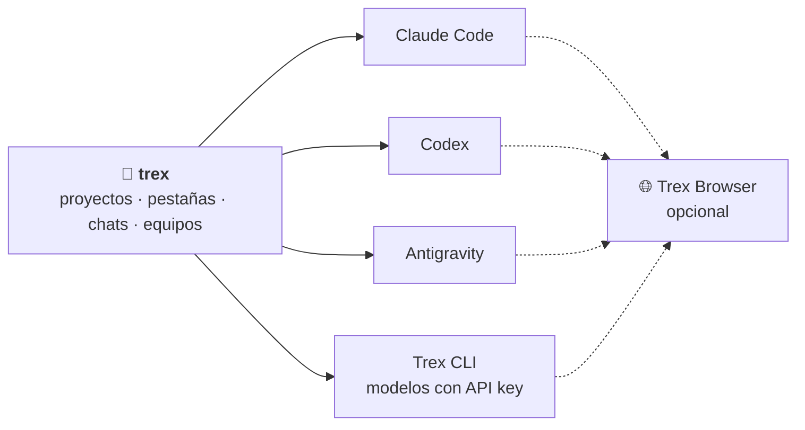
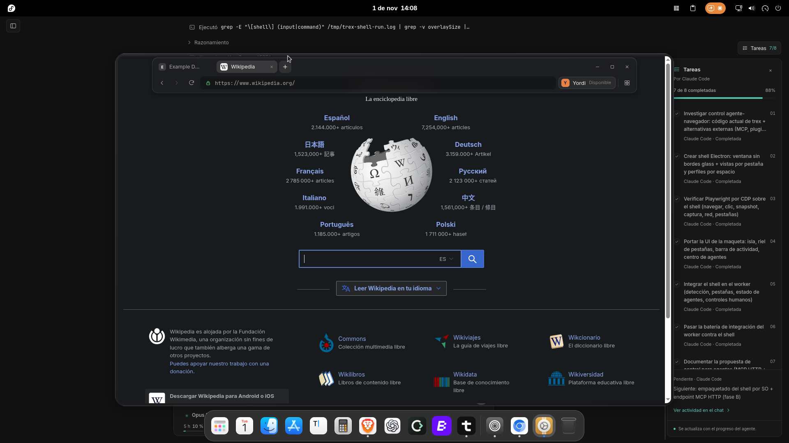

<p align="center">
  
</p>

<h1 align="center">trex</h1>

<p align="center">
  <b>La terminal de escritorio para trabajar con agentes de IA de programación.</b><br>
  Claude Code, Codex y más: ordenados por proyecto, en pestañas y en un solo lugar.
</p>

<p align="center">
  <a href="LICENSE"></a>
  
  
  
</p>

<p align="center">
  <a href="https://github.com/Y0RD1N/trex/releases/latest"><b>⬇️ Descargar</b></a> ·
  <a href="docs/guia.md">📖 Guía de uso</a> ·
  <a href="docs/desarrollo.md">🛠️ Desarrollo</a> ·
  <a href="SECURITY.md">🔒 Seguridad</a>
</p>

<p align="center"><sub>🇬🇧 <b>English:</b> trex is a desktop terminal for working with AI coding agents (Claude Code, Codex and more), organised by project. The app and its docs are currently in Spanish.</sub></p>

> [!NOTE]
> **trex está en fase inicial (v0.1).** Es un proyecto joven mantenido por una persona:
> puede haber errores y cambios entre versiones. Lo marcado como *experimental* se ha
> probado de forma limitada. Mira el [estado del proyecto](#-estado-del-proyecto).

---

## 🦖 ¿Qué es trex?

trex es una **terminal con proyectos**. Añades tus carpetas una sola vez y, dentro de
cada una, abres sesiones de **Claude Code**, **Codex** u otros asistentes (o un shell
normal) en pestañas, cada una con la cuenta y el perfil que elijas.

Como todo ocurre en el mismo sitio, trex puede hacer cosas que una terminal suelta no:
que **un modelo planifique y otro implemente**, **pasar el trabajo a otro asistente**
cuando a uno se le acaba la cuota, **coordinar un equipo de agentes** o darles un
**navegador** para probar lo que construyen.

> trex **no incluye** Claude Code ni Codex: instala el que uses. Sin ninguno, sigue
> funcionando como una terminal con pestañas y proyectos.

## ✨ Lo que puedes hacer

| Función | Qué hace |
|---|---|
| 📁 **Proyectos** | Añade carpetas una vez; quedan en la barra lateral con sus sesiones, y puedes marcar favoritos. |
| 🗂️ **Pestañas y paneles** | Varias terminales vivas a la vez. Divide en dos o en una cuadrícula 2 × 2, con foco independiente. |
| 🤖 **Perfiles de asistentes** | Claude Code, Codex, Antigravity, modelos con API key (Trex CLI) o los tuyos. Varias cuentas del mismo asistente, cada una con su carpeta de configuración. |
| 🧭 **Planificar e implementar** | Un modelo planifica en solo lectura y otro implementa: Claude → Codex, Codex → Claude o dos modelos del mismo perfil. |
| 👥 **Equipos de agentes** | Un coordinador y de 1 a 8 colaboradores (implementan, revisan, investigan…), con presupuesto de tokens y cuotas a la vista. |
| 🔁 **Continuar con otro asistente** | Traspasa el trabajo de un chat a otro perfil sin perder el contexto, incluso si el anterior se quedó sin cuota. |
| 📬 **Mensajes en cola** | Escribe mientras el agente trabaja; tus mensajes esperan en una bandeja que puedes editar, cancelar o enviar al instante. |
| 🌐 **Trex Browser** | Un navegador con perfiles privados por proyecto que los agentes pueden manejar y tú puedes pausar o tomar. |
| 🖱️ **Control de aplicaciones** *(experimental)* | Los agentes pueden usar otras apps mediante el árbol de accesibilidad del sistema, sin mover tu ratón ni tu teclado. |
| 🔔 **Comodidades** | Paleta de comandos (`Ctrl+K`), recuperar conversaciones, avisos de escritorio, atajos configurables, tema claro y oscuro. |

¿Quieres el detalle de cada una? Está en la **[guía de uso](docs/guia.md)**.

## 🧩 Cómo encaja todo



trex son tres piezas, y solo la primera es obligatoria:

| Pieza | Qué es | ¿Necesaria? |
|---|---|:---:|
| **trex** | La app de escritorio: terminal, proyectos, chats, planes y equipos. | ✅ Sí |
| **Trex CLI** | Agente propio para modelos con API key: DeepSeek, MiniMax, OpenRouter, Anthropic y cualquier endpoint compatible. | Opcional |
| **Trex Browser** | Navegador con Chrome o Chromium y perfiles privados, que los agentes controlan mediante herramientas MCP. | Opcional |

## ⬇️ Instalar

Descarga el instalador de tu sistema desde la
**[última versión](https://github.com/Y0RD1N/trex/releases/latest)**.

<details>
<summary><b>🪟 Windows</b></summary>

<br>

1. Ejecuta `trex_<versión>_x64-setup.exe`.
2. En el instalador puedes marcar los componentes opcionales **Trex CLI** (modelos con API key) y **Trex Browser**.
3. El instalador no tiene firma digital, así que Windows puede mostrar un aviso de SmartScreen.

</details>

<details>
<summary><b>🐧 Linux (Fedora)</b></summary>

<br>

Paquete RPM para x86-64, probado en Fedora 44. Incluye la app, Trex CLI y Trex Browser.

```bash
sudo dnf install ./trex-*.rpm chromium gnome-keyring
trex
```

Más detalles en [docs/fedora.md](docs/fedora.md). En otras distribuciones puedes
[compilar desde el código](docs/desarrollo.md#compilar-instaladores).

</details>

<details>
<summary><b>🍎 macOS (Apple Silicon)</b></summary>

<br>

1. Abre `trex_<versión>_aarch64.dmg` y arrastra trex a Aplicaciones.
2. La app lleva firma *ad hoc*, sin certificado de Apple: la primera vez ábrela con **clic derecho → Abrir**.
3. Trex Browser todavía no está disponible en macOS.

</details>

<details>
<summary><b>Instalar Claude Code o Codex</b></summary>

<br>

trex los detecta si están en tu `PATH` y te avisa si faltan. Para Claude Code:

```bash
# Windows (PowerShell)
irm https://claude.ai/install.ps1 | iex

# Linux y macOS
curl -fsSL https://claude.ai/install.sh | bash

# Alternativa con npm
npm install -g @anthropic-ai/claude-code
```

Cada asistente se autentica con su propio CLI; trex no copia tus credenciales.

</details>

## 🚀 Tu primera sesión

1. **Añade un proyecto**: elige la carpeta donde trabajas; quedará en la barra lateral.
2. **Abre una sesión** con el botón `+` y escoge un asistente (o `Ctrl+T` para el predeterminado).
3. **Trabaja**: abre más pestañas, divide la pantalla con `Ctrl+Shift+S` o pulsa `Ctrl+K` para buscar cualquier acción.
4. Prueba **Nueva sesión → Planear y ejecutar con agentes…** para que un modelo planifique y otro implemente.

Todos los atajos están en [la guía](docs/guia.md#atajos) y se pueden cambiar en **Ajustes → Atajos**.

## 🌐 Trex Browser

Cada agente trabaja en su **propio espacio** del navegador (cookies, almacenamiento, permisos
y descargas separados), y una ventana por proyecto agrupa las pestañas de todos. Desde ahí puedes
ver qué hace cada uno, pausarlo o tomar el control.

<p align="center">
  
  <br>
  <sub>Trex Browser en Fedora, con la barra de pestañas revelada sobre un chat con tareas.</sub>
</p>

En Windows usa tu Chrome; en Fedora, Chromium. Más en
[trex-browser/README.md](trex-browser/README.md) y [docs/agent-browser-spaces.md](docs/agent-browser-spaces.md).

## 🚦 Estado del proyecto

| Área | Estado |
|---|---|
| Terminal, proyectos, pestañas, perfiles de Claude Code y Codex, planificar e implementar, equipos y mensajes en cola | ✅ Disponible |
| Trex CLI y Trex Browser | ✅ Disponible (opcionales) |
| Control de aplicaciones por accesibilidad | 🧪 **Experimental** |
| Antigravity | 🧪 **Integración inicial**: probada en Windows con una cuenta real; las herramientas autenticadas y los turnos en Fedora aún requieren validación. La planificación de solo lectura, los equipos y el control de sus terminales internas están desactivados |
| macOS | Solo Apple Silicon, firma *ad hoc* y sin Trex Browser |
| Linux | Probado en Fedora 44 (RPM); otras distribuciones, sin instalador |
| Idioma | La interfaz y la documentación están en español |

## 📚 Documentación

| Documento | De qué trata |
|---|---|
| [Guía de uso](docs/guia.md) | Todas las funciones de trex, con detalle |
| [Trex CLI](trex-cli/README.md) · [protocolo](trex-cli/PROTOCOL.md) | Agente para modelos con API key y su protocolo JSON-RPC |
| [Trex Browser](trex-browser/README.md) | Navegador de los agentes: herramientas, modos y pruebas |
| [Espacios del navegador](docs/agent-browser-spaces.md) | Cómo se aíslan los datos de cada agente |
| [Integraciones de escritorio](docs/integraciones-escritorio.md) | Dependencias, GitHub CLI y control por accesibilidad |
| [Tareas en cualquier chat](docs/chat-task-tools.md) | Cómo se publican y se muestran las tareas |
| [Fedora](docs/fedora.md) | Instalación, llavero y compilación en Fedora |
| [Notas de versión](docs/releases/2026-11-02.md) | Novedades de cada actualización |

## 🛠️ Desarrollo

```bash
git clone https://github.com/Y0RD1N/trex.git
cd trex
npm install
npm run tauri dev
```

Necesitas Node 22.12+ o 24+ y Rust estable. La estructura del repositorio, las
comprobaciones y cómo compilar los instaladores están en **[docs/desarrollo.md](docs/desarrollo.md)**.

> [!NOTE]
> **Contribuciones:** por ahora no acepto pull requests; el proyecto sigue bajo mi
> control mientras madura. Sí puedes abrir issues con errores o ideas, o hacer tu propio
> fork (es MIT). Detalles en [CONTRIBUTING.md](CONTRIBUTING.md).

| Capa | Tecnología |
|---|---|
| Shell de escritorio | [Tauri v2](https://tauri.app) (Rust) |
| Interfaz | React 19 + TypeScript + Vite |
| Terminal | [xterm.js](https://xtermjs.org) y `portable-pty` (ConPTY en Windows, `openpty` en Unix) |
| Trex CLI y lanzador del navegador | Rust |
| Trex Browser | Node + Playwright, ventana en Electron |

## 🔒 Seguridad y privacidad

- trex **no tiene servidor propio ni envía telemetría**: tus datos solo viajan a los servicios que configuras.
- Las claves API de Trex CLI se guardan cifradas (DPAPI en Windows, llavero del sistema en Linux y macOS).
- Los agentes trabajan **con tus permisos** sobre tus archivos y tu shell. Revisa lo que aprueban, sobre todo en el modo «Permitir todo».

¿Encontraste una vulnerabilidad? Sigue [SECURITY.md](SECURITY.md) en lugar de abrir un issue público.

## 📄 Licencia

trex se publica bajo la **[licencia MIT](LICENSE)**. Incluye software de terceros con sus
propias licencias: consulta [THIRD-PARTY-NOTICES.md](THIRD-PARTY-NOTICES.md).

---

<p align="center"><sub>
  «Claude» y «Claude Code» son marcas de Anthropic; «Codex» y «ChatGPT», de OpenAI; «Antigravity» y «Gemini», de Google.<br>
  trex es un proyecto independiente, sin relación ni respaldo de esas empresas.
</sub></p>
